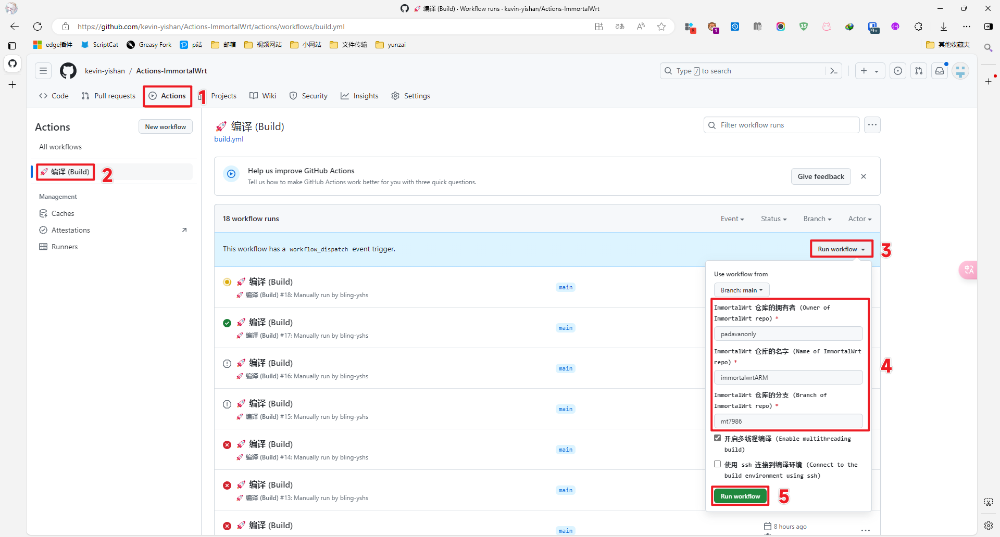
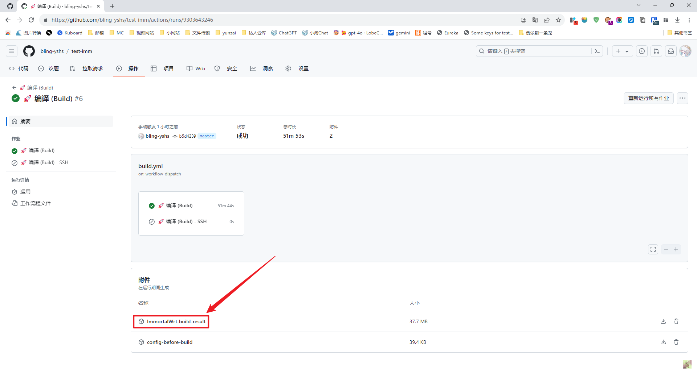
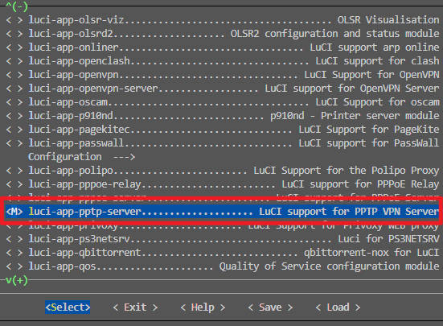

# ImmortalWrt 自动编译

## 使用步骤

### 正常流程

1. (必须) fork 本仓库
2. (必须) 上传 `.config` 文件到此仓库
3. 进入本仓库的 Actions 页面，在左侧选择 `🚀 编译 (Build)`，右侧点击 Run workflow，填入需要编译的仓库的信息，最后点击绿色的 Run workflow
4. 等待编译完成，大约需要 2-3 小时
5. 当页面像这样显示绿色的✅的时候，就说明编译完成了，点击进去到这个界面找到 ImmortalWrt ，就是编译后的固件了

## 如何定制 config 和 feeds：

1. 克隆对应分支的 openwrt 仓库(利用免费的 github codespaces 进行定制)

2. 下载依赖软件

   ```shell
   sudo apt-get update
   sudo apt-get install -y gawk
   ```

3. 按需下载第三方插件，例如：

   ```shell
   git clone --depth=1 https://github.com/EOYOHOO/UA2F.git package/UA2F
   ```

4. 更新 feeds

   ```shell
   ./scripts/feeds update -a && ./scripts/feeds install -a
   ```

5. 定制 config

   从仓库中复制已有的配置
   ```shell
   cp -f defconfig/mt7986-ax6000_dae.config .config
   ```
   定制自己的配置
   ```shell
   make menuconfig
   ```
   弹出插件配置界面，选择对应的 `Target System` ， `Subtarget` ， `Target Profile` ， 注意 `Target Profile` 必须精确到对应的设备名，否则理论上不兼容

6. 继续选择需要安装的插件，上下箭头移动，左右箭头切换底部选项卡，回车为选择进入，对着插件按`Y`会将插件前的标识变为 `*` ， `*` 代表此插件被选中安装

7. 选择好需要的插件以后，用左右箭头切换到 `save` 选项卡按回车保存

8. 合并下载

   ```shell
   zip conf.zip feeds.conf.default .config
   ```
   会将 `feeds.conf.default` 与 `.config` 两个文件压缩为 `conf.zip` ，将 `conf.zip` 下载到本地，然后解压可以得到自己定制好的 config 和 feed

## 编译之如何单独编译某一个模块

1. 想单独编译某一个模块，前提是你当前的环境已经编译过一次**完整的 openwrt 固件**才行，因为编译完整的 openwrt 固件时，它会自动编译工具链，没有工具链就没法单独编译模块，这一点你必须清楚地了解。如果你的当前环境已经编译过**完整的 openwrt 固件**了，但是还是显示缺少依赖，那么很抱歉，只能从头编译了

2. 确保你已经编译过一次完整的 openwrt 之后，先克隆对应仓库的地址到 package 文件夹下，格式如下：

   ```shell
   git clone --depth=1 仓库地址 package/项目名称
   ```
   例子：
   ```shell
   git clone --depth=1 https://github.com/iv7777/luci-app-pptp-server package/luci-app-pptp-server
   ```

3. 先清空下之前编译的残留物 `make clean`

4. 更新feeds

   ```shell
   ./scripts/feeds update -a && ./scripts/feeds install -a
   ```

5. 执行 `make menuconfig` ，选择对应的 Target System，Subtarget，Target Profile

6. 找到对应的模块的位置，将其选定，标记为`M`，`M`代表以模块方式编译出 ipk 文件。选中以后记得选择 Save 保存

7. 开始编译吧，格式如下：

    ```shell
    make package/项目名称/compile V=s
    ```
   例子：
   ```shell
   make package/luci-app-pptp-server/compile V=s
   ```